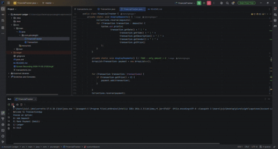
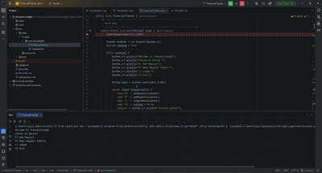

# Accounting Ledger

A console-based accounting application that allows users to record deposits and payments, 
view ledger entries, and search transactions by date, description, vendor, and amount.


## Description of the Project

Accounting Ledger is a Java command-line application designed to help users track financial transactions. 
Users can add deposits and payments to a transaction ledger, which is stored in a CSV file. The application allows
users to view all transactions, filter entries by date, and perform custom searches using any combination of search fields.
The project demonstrates file handling, collections, user input, date comparisons, conditional filtering, and object-oriented programming in Java.
## Features

* Adds deposits to the accounting ledger.
* Adds payment transactions to the accounting ledger.
* Saves transactions to a CSV file.
* Loads previously saved transactions when the application starts.
* Displays all ledger transactions.
* Displays only deposit transactions.
* Displays only payment transactions.
* Displays transactions from the current month.
* Displays transactions from the previous month.
* Displays transactions from the current year.
* Displays transactions from the previous year.
* Allows users to perform a custom search.
* Custom search can filter by:
* Start date
* End date
* Description
* Vendor
* Amount
* Allows users to skip any custom-search field by pressing Enter.
* Uses date comparisons to include only transactions within a selected date range.
* Displays a message when no transactions match the selected criteria.
* Includes a customized application title and console menu.


## User Stories

* As a user, I want to add a deposit so that I can record money added to my account.

* As a user, I want to make a payment so that I can record money spent from my account.

* As a user, I want my transactions to be saved to a file so that my information is not lost when I close the application.

* As a user, I want to view all ledger entries so that I can review my complete transaction history.

* As a user, I want to view only deposits so that I can see the money added to my account.

* As a user, I want to view only payments so that I can see the money I have spent.

* As a user, I want to search transactions by date range so that I can view transactions from a specific period.

* As a user, I want to search transactions by description or vendor so that I can find a particular transaction.

* As a user, I want to search transactions by amount so that I can locate a payment or deposit with a specific value.

* As a user, I want to leave search fields blank so that I can filter only by the information I know.

* As a user, I want to receive a message when no transactions match my search so that I know the search was completed successfully.
* ## Setup

### Prerequisites

- Java 17 (Amazon Corretto), the version used in class.
- IntelliJ IDEA Community Edition: <https://www.jetbrains.com/idea/download/>

### Running the application

1. Clone this repository, or download it as a zip and unzip it.
2. In IntelliJ: File > Open, pick the project folder (the one that holds `pom.xml`), press Open.
3. Wait for IntelliJ to finish indexing (progress bar at the bottom).
4. Open `src/main/java/com/pluralsight/YourMainClassName.java`. <!-- replace YourMainClassName with the class that has main -->
5. Right-click inside the file and choose Run 'YourMainClassName.main()'.


## Technologies Used

- Java 17
- IntelliJ IDEA
<!-- Add anything else you used: a library, Maven plugins, an external tool. For a console app this list is short. That is fine. -->

## Demo


<!-- Pictures of the app running: the console for a console app, Insomnia or Swagger for an API.
     Screenshots are enough; a GIF is a bonus.
     1. Create a folder named `images` at the project root, next to `pom.xml`.
     2. Take screenshots of the app in the IntelliJ console (the menu, one feature, one error message):
          Windows: Win + Shift + S, drag a rectangle, then paste into Paint and save as PNG, or open the
                   notification and save. Save into the `images` folder.
          Mac:     Shift + Cmd + 4, drag a rectangle. The file lands on the Desktop; move it into `images`.
     3. Name the files by what they show: `images/menu.png`, `images/search.png`.
     4. Reference each one below with a relative path. No spaces in file names.
     5. Commit the images with the rest of your work (Git > Commit shows them as unversioned files: tick them).
     Optional GIF: LICEcap (free, Windows and Mac, <https://www.cockos.com/licecap/>) records a region of the
     screen straight to a .gif. Keep it under 10 seconds and under 10 MB, save it into `images`. -->





## A piece of code I am proud of

<!-- Paste one short block of your own code (5 to 15 lines) between the three backticks, then write two
     or three sentences: what it does and why you chose to write it that way. This is what you show on
     demo day and what you talk about in an interview. -->
```java
LocalDate today = LocalDate.now();

// calculate the date range for the previous calendar year
LocalDate start = today.withDayOfYear(1).minusYears(1);
LocalDate end = today.withDayOfYear(1).minusDays(1);


```

## Future Work


-work more on the design 


## Resources


- Java YearUp Fall 2026 hub: <https://raymaroun.github.io/yearup-java-fall2026/>
- orace: <https://docs.oracle.com/en/java//>

## Author


**Nahom Hagos**

## Thanks


Thank you to Raymound ! for teaching me how to code !!!